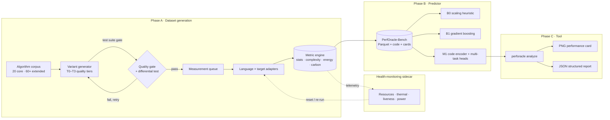

<div align="center">

# PerfOracle

**Learning to predict algorithm performance across programming languages and hardware — from microcontrollers to edge AI.**

[](https://github.com/ninja-bean/PerfOracle/actions/workflows/ci.yml)
[](LICENSE)
[](pyproject.toml)
[](#project-status)

Final Year Design Project · Department of Computer Science and Engineering
United International University · Dhaka, Bangladesh · November 2026

</div>

---

## Overview

A developer targeting an embedded or edge device cannot know how a piece of code
will perform until it is built, flashed and measured on that device. Big-O
notation describes growth rate, but it omits the factors that dominate on small
hardware: interpreter overhead, hard memory ceilings, and energy cost.

**PerfOracle** closes that gap. It predicts how unseen source code will perform on
a specified language runtime and hardware target — runtime, peak memory, empirical
complexity, energy, carbon and whether the code fits on the target at all.

The project has three parts:

| Phase | Deliverable | What it produces |
| :--- | :--- | :--- |
| **A — Dataset** | Automated benchmark harness | A measured, versioned dataset of algorithm implementations across languages, quality tiers and hardware targets |
| **B — Predictor** | Learned performance model | Runtime curves, memory, complexity class, energy and fits-on-target probability with confidence estimates |
| **C — Tool** | `perforacle` CLI | A PNG performance card and a structured JSON report from a single command |

To our knowledge, no existing dataset or tool jointly covers the
microcontroller-to-desktop hardware spectrum, multiple language runtimes, and
controlled implementation quality with energy and fit-on-target labels.

### Why this is hard

- **Constant factors dominate.** An interpreter on a 160 MHz microcontroller
  behaves nothing like CPython on a desktop.
- **Memory is a first-order constraint.** The ESP8266 offers roughly 80 KB of
  usable data RAM, so "does it fit?" precedes "how fast is it?".
- **Energy is invisible at design time.** Battery-powered and IoT deployments pay
  for inefficiency in joules, not milliseconds.
- **Runtime choice changes the asymptotics in practice.** CPython special-cases
  repeated string concatenation; MicroPython may not.

---

## Architecture



The dashed link marks the health-monitoring sidecar, which observes, resets and
re-runs the execution environment independently of the code under test. On
microcontrollers the sidecar is an external Raspberry Pi connected over UART, GPIO
and an INA226 power sensor.

See [`docs/architecture.md`](docs/architecture.md) for component responsibilities
and [`docs/proposal.md`](docs/proposal.md) for the full methodology.

---

## Repository layout

```text
PerfOracle/
├── .github/
│   ├── CODEOWNERS                  # Review policy for `main`
│   ├── ISSUE_TEMPLATE/             # Bug and feature request forms
│   ├── PULL_REQUEST_TEMPLATE.md
│   └── workflows/ci.yml            # Lint, test, required status check
├── benchmarks/
│   ├── corpus/                     # <algorithm>/<language>/<tier>.*
│   └── README.md                   # Corpus conventions and rubric
├── configs/                        # YAML experiment and sweep definitions
├── docs/
│   ├── proposal.md                 # FYDP proposal (source of truth for scope)
│   ├── architecture.md
│   ├── dataset-schema.md
│   └── evaluation.md
├── scripts/                        # Operational helpers (flashing, calibration)
├── src/perforacle/
│   ├── cli.py                      # Typer command surface
│   ├── schema.py                   # Pydantic measurement-record schema
│   ├── targets.py                  # Hardware target catalogue
│   ├── harness/                    # Adapters and orchestration
│   ├── metrics/                    # Statistics and complexity fitting
│   ├── predictor/                  # B0/B1/M1 models
│   └── render/                     # Performance-card rendering
└── tests/                          # pytest suite
```

---

## Quickstart

**Requirements:** Python 3.11 or newer, and `git`.

```bash
# 1. Clone
git clone https://github.com/ninja-bean/PerfOracle.git
cd PerfOracle

# 2. Create an isolated environment
python -m venv .venv
# Windows: .venv\Scripts\activate
source .venv/bin/activate

# 3. Install the package with development tooling
python -m pip install --upgrade pip
python -m pip install -e ".[dev]"

# 4. Verify the install
perforacle version
perforacle targets --core-only
pytest -q
```

The prediction pipeline is not implemented yet. The command surface is in place
and `perforacle analyze` fails with an explicit Phase C message:

```console
$ perforacle analyze benchmarks/corpus/bubble_sort/python/T1.py --lang python --target esp32
perforacle analyze is not implemented yet (Phase C). ...
```

Structured records can already be validated against the dataset schema:

```bash
perforacle validate path/to/record.json
```

---

## Scope

| | **Core scope (committed)** | **Extended scope (if time permits)** |
| :--- | :--- | :--- |
| **Languages** | Python, C, Rust | C++, JavaScript, TypeScript, PHP, Go |
| **Targets** | Apple M5, Raspberry Pi 5, Pi Zero 2 W, ESP32, ESP8266, Teensy 4.1 | Jetson Orin Nano, ESP32-S3, x86-64, Android (Termux), constrained containers |
| **Algorithms** | 20 | 60+ |
| **Models** | B0, B1, M1 | M2 (fine-tuned code LLM) |
| **Tool** | CLI with PNG card | Web interface, multi-target comparison, optimisation suggestions |

### Hardware targets

| Tier | Target | CPU / clock | RAM | Execution mode |
| :--- | :--- | :--- | :--- | :--- |
| Desktop | Apple M5 | Apple Silicon (arm64) | 16 GB+ | `native` |
| Edge AI | NVIDIA Jetson Orin Nano | 6× Cortex-A78AE | 8 GB | `physical_board` |
| SBC | Raspberry Pi 5 | 4× Cortex-A76 @ 2.4 GHz | 4–8 GB | `physical_board` |
| SBC | Raspberry Pi Zero 2 W | 4× Cortex-A53 @ 1 GHz | 512 MB | `physical_board` |
| MCU | Teensy 4.1 | Cortex-M7 @ 600 MHz | 1 MB SRAM | `physical_board` |
| MCU | ESP32-S3 | 2× Xtensa LX7 @ 240 MHz | 512 KB SRAM | `physical_board` |
| MCU | ESP32 (classic) | 2× Xtensa LX6 @ 240 MHz | 520 KB SRAM | `physical_board` |
| MCU | ESP8266 | Xtensa L106 @ 80/160 MHz | ~80 KB user RAM | `physical_board` |

Every record stores its `execution_mode`; emulated and synthetic results are
flagged and never silently substituted for physical measurements.

---

## Metrics captured

| Category | Metrics |
| :--- | :--- |
| **Time** | Median and p95 wall-clock time, CPU cycles, instructions retired, coefficient of variation |
| **Space** | Peak RSS / heap high-water mark, stack usage, flash footprint |
| **Complexity** | Empirical class, log-log slope, fit R², curated theoretical Big-O |
| **Energy** | Energy per run, average power, Energy-Delay Product |
| **Carbon** | Derived emissions = energy × grid intensity (gCO₂e/kWh) |
| **Efficiency** | Throughput, throughput per watt, normalised score against the C/T3 baseline |
| **Code quality** | LOC, cyclomatic complexity, Halstead volume, maintainability index |
| **Reliability** | Correctness, crash / OOM / timeout flags, fits-on-target |

Full field definitions and units: [`docs/dataset-schema.md`](docs/dataset-schema.md).

---

## Evaluation plan

A random split alone overstates model quality, so four splits are reported. The
**held-out-algorithm split is the primary measure**.

| Split | What it tests |
| :--- | :--- |
| Random | Interpolation within seen algorithms (low difficulty) |
| **Held-out algorithm** | **Generalisation to unseen code (primary)** |
| Leave-one-target-out | Generalisation to unseen hardware |
| Held-out tier | Assessment of unseen quality levels |

Provisional targets, to be refined after the pilot study:

| Output | Metric | Target |
| :--- | :--- | :--- |
| Complexity class | Macro-F1 (held-out algorithms) | ≥ 0.75 |
| Runtime | Share of predictions within 2× measured | ≥ 80% |
| Tier ranking on a target | Spearman's ρ | ≥ 0.8 |
| Fits-on-target / OOM | F1 | ≥ 0.9 |
| Baseline comparison | M1 vs B0 and B1 | Better on all primary metrics |

Details: [`docs/evaluation.md`](docs/evaluation.md).

---

## Roadmap

| Phase | Duration | Milestones |
| :--- | :--- | :--- |
| **P1 — Foundation** | ~4 months | Literature review · corpus and tier rubric finalised · harness operational on M5, Raspberry Pi 5 and ESP32 · pilot study · proposal defence |
| **P2 — Dataset** | ~4 months | All core targets operational · variant generator with validation gate · core dataset (~57,600 executions) · baselines B0/B1 · calibration study |
| **P3 — Model & Tool** | ~4 months | M1 trained and evaluated on all splits · CLI and card renderer · extended scope as time permits · thesis and paper draft · public dataset release |

### Project status

Pre-alpha. The repository currently contains the research scaffold: dataset
schema, target catalogue, complexity-fitting utilities, the B0 baseline, and the
CLI shell. Measurement, prediction and rendering land in P1–P3.

---

## Team

| Member | Student ID | GitHub | Work stream |
| :--- | :--- | :--- | :--- |
| Rayian Bin Shiraz Mahi | 0112330146 | [@xrayian](https://github.com/xrayian) | WS1 — Benchmark harness & embedded targets |
| Injabin Alam | 0112330344 | [@ninja-bean](https://github.com/ninja-bean) | WS2 — Corpus & variant generation |
| Fardin Jany Raad | 0112331148 | [@Janyraad](https://github.com/Janyraad) | WS3 — Data pipeline & metrics |
| Jahid Hassan Sabbir | 0112330978 | [@jahidhassan18](https://github.com/jahidhassan18) | WS4 — Predictor & tool |

**Supervisors:** Mr. Md. Tarek Hasan (Assistant Professor, Dept. of CSE & UG
Program Coordinator) and Ms. Siana Rizwan (Lecturer, Dept. of CSE).

---

## Contributing

`main` is protected: every change lands through a pull request that requires one
approving review from a code owner ([@xrayian](https://github.com/xrayian) or
[@ninja-bean](https://github.com/ninja-bean)), a passing CI run, and resolved
conversations. Force pushes and branch deletion are blocked for everyone,
including administrators.

Start with [`CONTRIBUTING.md`](CONTRIBUTING.md) for branching, commit
conventions, the tier rubric and corpus rules. Security issues go through
[`SECURITY.md`](SECURITY.md), never a public issue.

---

## Citation

If you reference this work, please cite it using [`CITATION.cff`](CITATION.cff):

```bibtex
@software{perforacle2026,
  title   = {PerfOracle: Predicting Algorithm Performance Across Programming
             Languages and Hardware, from Microcontrollers to Edge AI},
  author  = {Mahi, Rayian Bin Shiraz and Alam, Injabin and Raad, Fardin Jany
             and Sabbir, Jahid Hassan},
  year    = {2026},
  url     = {https://github.com/ninja-bean/PerfOracle},
  license = {Apache-2.0}
}
```

---

## License

Released under the [Apache License 2.0](LICENSE). See [`NOTICE`](NOTICE) for
attribution.

<div align="center">
<sub>Department of CSE · United International University · Final Year Design Project</sub>
</div>
